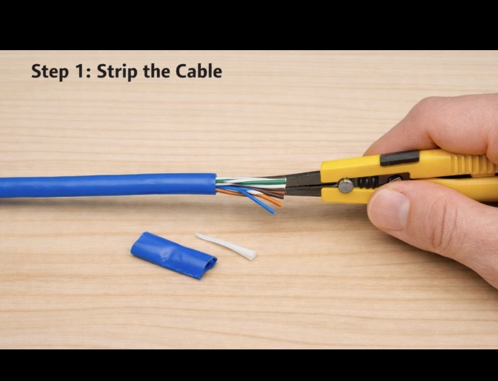
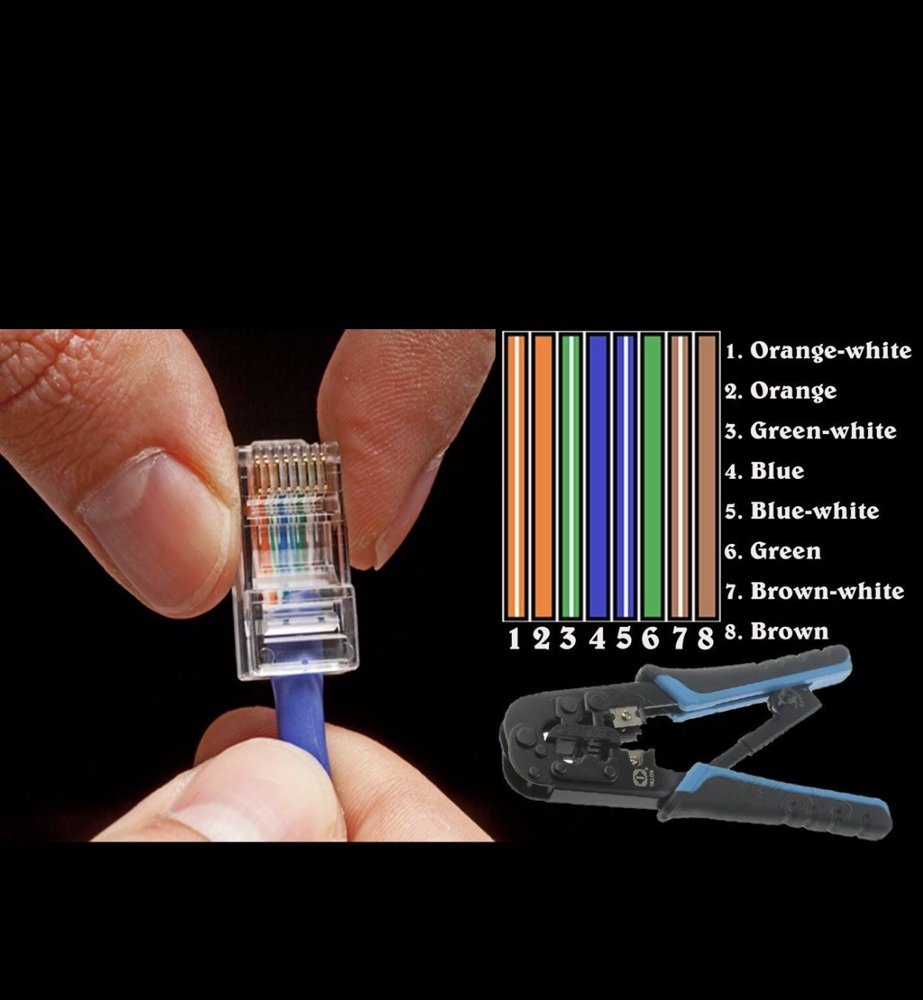
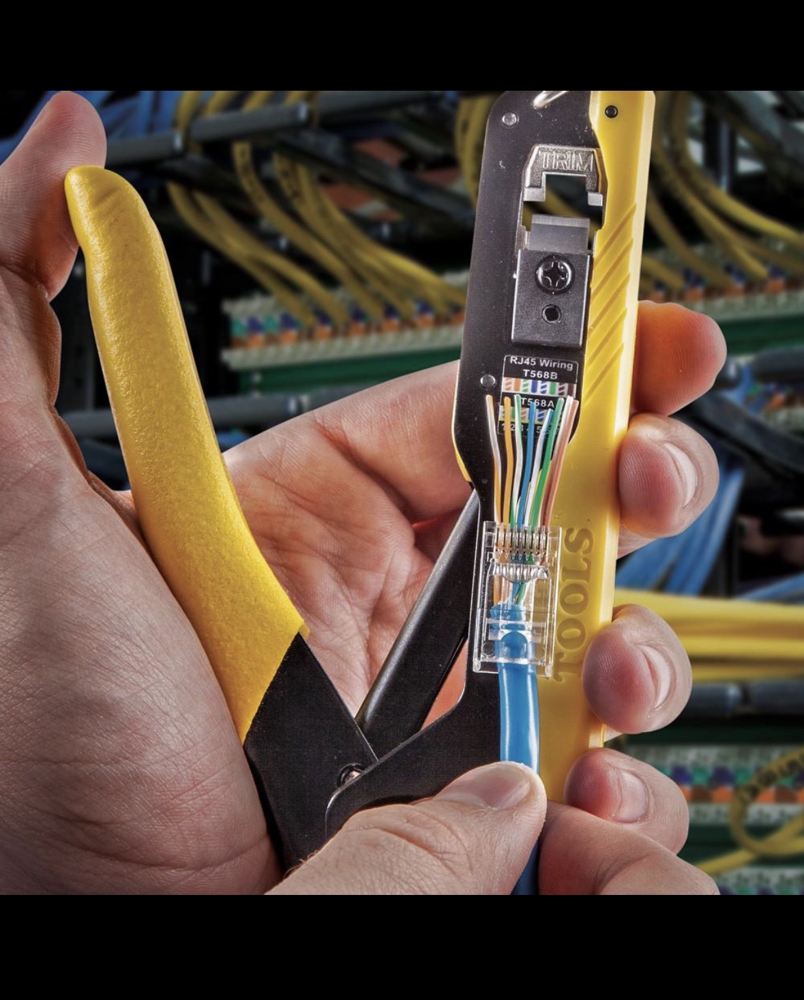

Day 4: Network Cable Types and Tools

Task 1: Ethernet Cable vs Fiber Optic Cable

Feature	Ethernet Cable	Fiber Optic Cable
1. Material	Uses copper wires	Uses glass or plastic fibers
2. Speed	Supports high speeds, depending on cable category	Supports very high speeds over long distances
3. Distance	Common Ethernet copper links support up to 100 meters	Can transmit data over much longer distances

Real-world examples:

* Ethernet cables are used to connect computers to home Wi-Fi routers and switches.
* Fiber optic cables are used by internet service providers and data centers for high-speed, long-distance connections.
Task-2 showing the internal wiring of a straight through Ethernet cable

Task-3 how to use RJ45 crimper, write a step-by-step guide in your own words on how to attach an RJ45 connecter to CAT6 cable
Task 3: Steps to Attach an RJ45 Connector

1. Strip approximately 2–3 cm of the outer cable jacket.
2. Untwist and straighten the eight wires.
3. Arrange the wires in T568B color order.
4. Trim the wires evenly.
5. Insert the wires fully into the RJ45 connector.
6. Place the connector into the RJ45 crimper and squeeze firmly.
7. Test the finished cable using a network cable tester.

Note: Both ends must use the T568B order for a straight-through cable.

Task-4 network setup for a gaming cafe
Task 4: Network Setup for a Gaming Cafe

For a gaming cafe with 10 PCs, I would use Cat6 Ethernet cables to connect all PCs to a Gigabit Ethernet switch.

Cable choice: Cat6 Ethernet cable.

Tool choice: RJ45 crimper for attaching connectors and a network cable tester for checking the cables.

Reasons:

* Cat6 supports Gigabit Ethernet and can support 10 Gbps over shorter distances under suitable conditions.
* Ethernet provides a stable, low-latency connection for online gaming.
* It is affordable and easy to install for a small gaming cafe.
* Each PC can be connected directly to a network switch.

Conclusion: Cat6 Ethernet cables are a practical and cost-effective choice for connecting 10 gaming PCs. Fiber optic cable would be worth considering for longer backbone links or higher bandwidth requirements.
