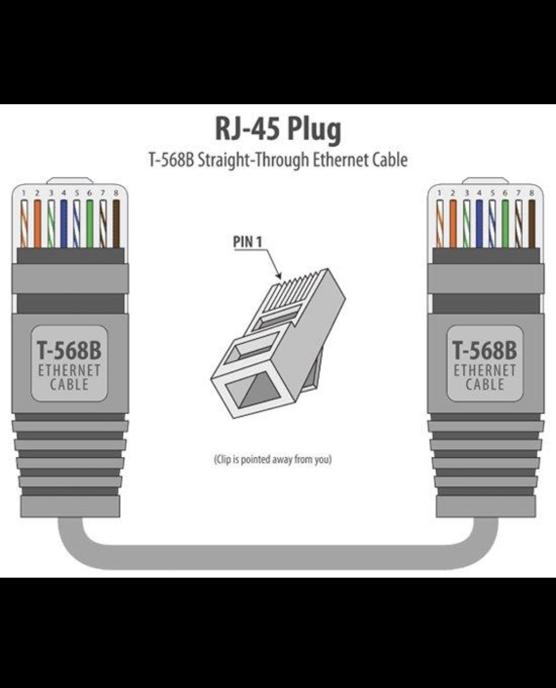

Day 4: Network Cable Types and Tools

Task 1: Ethernet Cable vs Fiber Optic Cable

Feature	Ethernet Cable	Fiber Optic Cable
1. Material	Uses copper wires	Uses glass or plastic fibers
2. Speed	Supports high speeds, depending on cable category	Supports very high speeds over long distances
3. Distance	Common Ethernet copper links support up to 100 meters	Can transmit data over much longer distances

Real-world examples:

* Ethernet cables are used to connect computers to home Wi-Fi routers and switches.
* Fiber optic cables are used by internet service providers and data centers for high-speed, long-distance connections.
Task-2 showing the internal wiring of a straight through Ethernet cable

